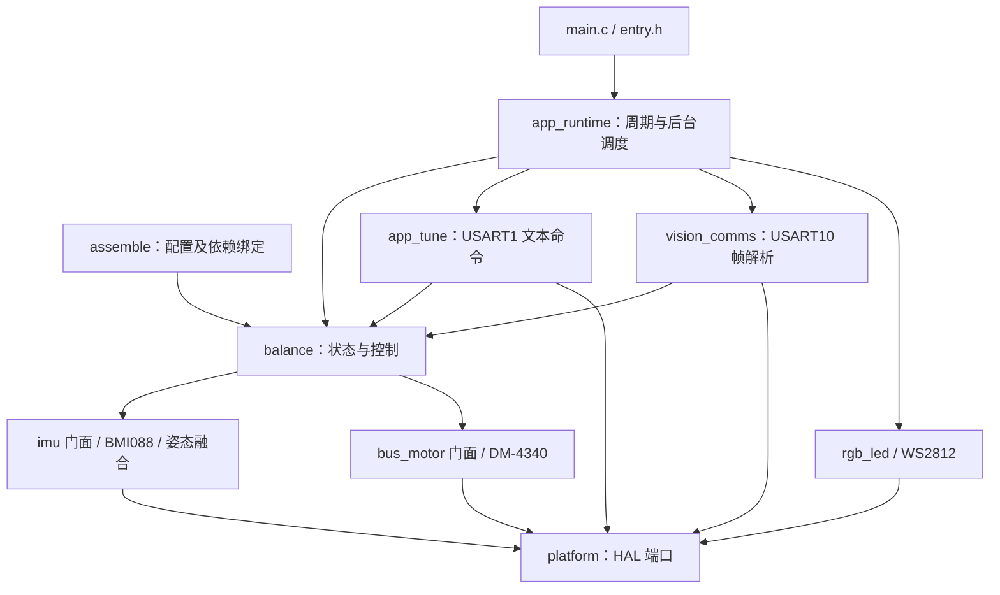
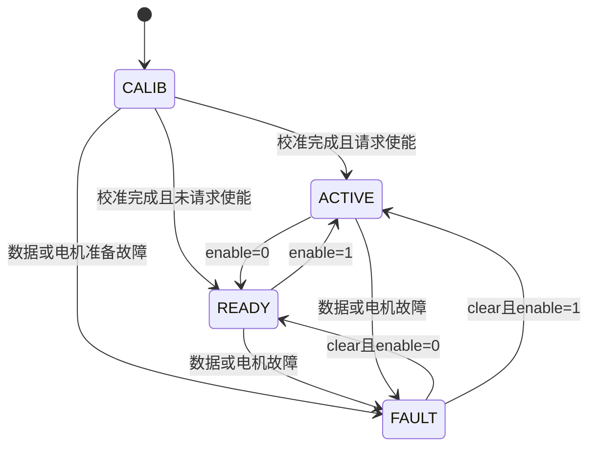

# 2026TI-match-ball-system

2026年电赛小车H题目代码开源，平衡球系统整合。

本文整合原根目录简介、现有 `docs/README.md` 中的模块说明与调试经验，并以当前源代码、`robot.ioc` 和本地生成的 HAL 初始化文件核对实际行为。默认值以 `src/app/app_config.h` 为准。文中的调试建议需要结合实际机构验证，不代表已经完成实机验收。

## 目录

1. [系统用途与边界](#1-系统用途与边界)
2. [目录与代码架构](#2-目录与代码架构)
3. [硬件连接和外设](#3-硬件连接和外设)
4. [构建与下载](#4-构建与下载)
5. [启动、调度与状态机](#5-启动调度与状态机)
6. [控制算法与单位](#6-控制算法与单位)
7. [完整参数说明](#7-完整参数说明)
8. [串口调参操作](#8-串口调参操作)
9. [视觉二进制协议](#9-视觉二进制协议)
10. [从首次上电到联调](#10-从首次上电到联调)
11. [日志、灯光与故障排查](#11-日志灯光与故障排查)
12. [维护与实现限制](#12-维护与实现限制)

## 1. 系统用途与边界

当前固件运行在 STM32H723VGTX 上，负责一轴滚球机构的摆杆控制：读取 BMI088 姿态和纵向加速度，接收外部视觉设备提供的球位置偏移及速度，计算目标角度，通过 FDCAN1 驱动 DM-4340 电机。USART1 同时提供日志和文本调参，SPI6 驱动 WS2812 状态灯，PA2 接收车辆出发信号。

完整闭环需要下列外部部分配合：

- 视觉端：识别球、选择目标位置、计算像素偏移与像素速度，按协议发送数据；本目录没有相机识别程序。
- 车辆端：底盘运动、循迹、速度规划以及出发信号来源由外部系统实现；本固件没有完整底盘循迹控制逻辑。
- 执行机构：电机、电源、摆杆、球道及机械限位。`hardware/` 提供电控与机械工程文件，不等于这些设备均由本固件控制。

MCU 的球位置目标恒为 `offset_px = 0`。改变球的保持位置，应在视觉端改变参考位置并重新计算偏移，MCU 不接收绝对球位目标。

## 2. 目录与代码架构

```text
stm32-transfer/
├── README.md                         本文，完整使用入口
├── robot.ioc                         CubeMX 外设与引脚配置
├── robot.code-workspace              VS Code 工作区
├── .eide/                            Embedded IDE 构建、下载配置
├── Core/                             HAL 生成代码、启动文件
│   └── Src/main.c                    HAL 初始化及 entry 入口
├── Drivers/                          STM32 HAL、CMSIS
├── STM32H723VGTX_FLASH_USER.ld        Debug 自定义链接脚本
├── src/
│   ├── app/                          默认配置、调度、调参
│   ├── service/                      平衡控制、视觉通信
│   │   └── assemble/                 依赖绑定、端口与参数装配
│   ├── device/                       电机、IMU、灯驱动
│   ├── platform/                     STM32 HAL 适配与中断分发
│   ├── infra/                        通用协议、日志、数学工具
│   └── domain/kalman/                通用 Kalman 算法
├── hardware/control/                 电源板、MSPM0 电控工程
├── hardware/mech/                    SolidWorks、STEP 机械模型
├── docs/README.md                    本地旧版说明，部分内容已过时
└── build/                            本机构建产物
```

注意 `.gitignore` 忽略 `Drivers/`、大部分 `Core/`、`docs/` 和 `build/`。这些目录在当前电脑上存在，不保证重新克隆后齐全；根目录 README 不依赖旧说明才能理解系统。

### 2.1 架构理解

系统采用裸机超级循环，没有 RTOS，也没有独立的 HFSM 框架。`assemble` 是依赖装配入口：把抽象设备接口绑定到具体驱动，把驱动端口绑定到 HAL，再向业务服务注入时间源和参数。



`imu`、`bus_motor`、`rgb_led` 通过接口表访问当前实例；算法与外设细节分离。移植主控通常修改 `platform`、CubeMX 配置和装配层；修改控制策略主要看 `balance.c`；改视觉数据格式看 `vision_comms.c` 和 `binary_frame.c`。

### 2.2 主要文件职责

下表中的 `.c/.h` 表示对应实现与公共接口文件。

| 路径 | 职责与阅读重点 |
|---|---|
| `src/app/entry.h` | `entry_init()` 顺序初始化；`entry_loop()` 原子取出定时任务并执行后台任务 |
| `src/app/app_config.h` | 应用默认参数、安装方向、校准和调参缓冲区 |
| `src/app/app_runtime.c/.h` | 实际 dt、500 Hz 控制、10 Hz 状态与 RGB、1 Hz 日志 |
| `src/app/app_tune.c/.h` | USART1 接收队列、文本解析、参数校验、控制命令和回复 |
| `src/service/balance.c/.h` | 状态机、上电零偏、滤波、视觉 PID 与速度前馈、目标限幅、电机管理 |
| `src/service/vision_comms.c/.h` | 字节入队、CRC 检查、球位/命令分发、状态与 ACK |
| `src/service/assemble/assemble.h` | 装配接口、系统状态、TIM6 待执行计数 |
| `assemble_delay.c` | DWT 与 HAL 时基，1500 ms 上电等待 |
| `assemble_log.c` | INFO 彩色日志绑定 USART1 |
| `assemble_rgb.c` | WS2812 实例、颜色缓存、D3 发送缓存、SPI6 回调 |
| `assemble_imu.c` | 绑定 `bmi088_blocking_instance`，配置与初始化 IMU |
| `assemble_vision.c` | USART10 单字节中断接收、通信时基与发送端口 |
| `assemble_motor.c` | FDCAN1、ID、反馈过滤、校准后的电机准备 |
| `assemble_balance.c` | 把 `APP_CFG_*` 填入 `BalanceConfig`，读取 PA2 |
| `assemble_tim.c` | TIM6 回调仅递增 pending，业务计算留在主循环 |
| `src/device/bus_motor/bus_motor.c/.h` | 电机统一接口和反馈数据类型 |
| `src/device/bus_motor/dm_motor.c/.h` | DM 协议编码、模式应答、反馈、命令缓存；支持多种模式，应用固定 MIT |
| `src/device/imu/imu.c/.h` | IMU 统一接口，采样、姿态与融合配置类型 |
| `src/device/imu/bmi088.c/.h` | 寄存器初始化、阻塞/异步采样、温度和姿态更新 |
| `src/device/imu/imu_attitude.c/.h` | Mahony/互补融合、陀螺零偏、温度补偿、四元数与欧拉角 |
| `src/device/rgb_led/rgb_led.c/.h` | 灯光统一接口 |
| `src/device/rgb_led/ws2812_rgb_led.c/.h` | SPI 波形编码、默认 8 灯、异步完成处理 |
| `src/platform/stm32_hal_bmi088.c/.h` | SPI2、片选、EXTI、DMA 和 cache 维护 |
| `src/platform/stm32_hal_can.c/.h` | Classic CAN 收发、FIFO0 分发、CAN1 收发器使能 |
| `src/platform/stm32_hal_uart.c/.h` | USART1/10 中断发送队列、接收与错误回调 |
| `src/platform/stm32_hal_spi.c/.h` | SPI6 DMA 发送、SPI2/SPI6 回调分发 |
| `src/platform/stm32_hal_tim.c/.h` | TIM6 启停及 HAL 周期回调 |
| `src/platform/stm32_hal_exti.c/.h` | EXTI 回调注册与分发 |
| `src/platform/stm32_hal_dwt.c/.h` | Cortex-M7 周期计数与微秒时间戳 |
| `src/infra/binary_frame.c/.h` | 帧封装、CRC16、大小端、单位转换 |
| `src/infra/protocol_parser.c/.h` | 环形缓冲、帧头/长度/CRC 流式解析 |
| `src/infra/log.c/.h` | 日志等级、颜色、VOFA、可选异步缓冲 |
| `src/infra/delay.c/.h` | 可注入时基的延时与超时工具 |
| `src/infra/pid.c/.h` | 通用 PID，支持死区、抗饱和、微分滤波、变化率限制等；当前滚球环没有调用它 |
| `src/infra/matrix.c/.h` | 矩阵、向量、四元数基础运算 |
| `src/domain/kalman/kalman.c/.h` | 通用离散 Kalman 预测更新，当前滚球控制未直接使用 |

视觉 PID 当前直接实现在 `balance_set_vision()`，不能通过修改通用 `pid.c` 来调节当前球环。

## 3. 硬件连接和外设

以下引脚按 MCU 信号命名，具体板上插座位置和电源接线需结合硬件工程核对。

| 功能 | 外设 / 引脚 | 当前配置 |
|---|---|---|
| 主控 | STM32H723VGTX / Cortex-M7 | HSE 24 MHz，SYSCLK 500 MHz，HCLK 250 MHz |
| 日志与调参 | USART1 TX=PA9、RX=PA10 | 921600，8N1；同一串口双向使用 |
| 视觉通信 | USART10 TX=PE3、RX=PE2 | **115200，8N1**，以当前 `robot.ioc` 和 `Core/Src/usart.c` 为准 |
| 电机 | FDCAN1 TX=PD1、RX=PD0 | 1 Mbit/s，Classic CAN；需收发器连接 CANH/CANL |
| CAN1 使能 | PC14 / CAN1_EN | 平台层启动时拉高 |
| BMI088 SPI | SPI2 SCK=PB13、MOSI=PC1、MISO=PC2_C | 6.25 Mbit/s，CPOL 高、第二边沿 |
| BMI088 片选 | ACC_CS=PC0、GYRO_CS=PC3_C | 分别选择加速度计与陀螺仪 |
| BMI088 中断 | ACC_INT=PE10、GYRO_INT=PE12 | 平台支持中断/异步，但应用绑定阻塞采样实例 |
| RGB | SPI6 MOSI=PA7、SCK=PA5 | 6 Mbit/s，BDMA，8 颗 WS2812；数据由 MOSI 输出 |
| 出发输入 | PA2 / CAR_START | 下拉输入，高有效，持续电平触发 |
| 调试下载 | PA13=SWDIO、PA14=SWCLK | 与探针共地，按板卡接线 |
| 预留外设 | FDCAN2 PB5/PB6、UART7 PE7/PE8、UART5 PC12/PD2 | main 初始化，但未接入当前滚球业务 |

**视觉波特率存在文字冲突：** `assemble_vision.c` 的启动日志写 `1000000 8N1`，但它没有设置波特率。当前生成代码实际初始化为 **115200**。连接相机时应匹配 115200；将来重新生成外设后也应核对真实初始化值。

串口交叉连接 TX→RX、RX←TX，并共地。串口 IO 应匹配板卡逻辑电平。CAN 通过收发器连接，结合总线布线确认两端终端电阻。电机供电规格以电机及电源硬件为准。

## 4. 构建与下载

### 4.1 工程准备

1. 使用 VS Code 打开 `robot.code-workspace`，加载 Embedded IDE（`cl.eide`）。
2. 配置 Arm GNU GCC 工具链。链接脚本使用 `READONLY` 语法，优先使用 GCC 11 或更新且兼容本工程的工具链。
3. 检查 `Drivers/`、`Core/Inc/`、`Core/Startup/` 和生成的外设 `.c` 是否齐全。全新克隆缺失时，用 `robot.ioc` 和配套 STM32CubeH7 固件包恢复生成依赖。
4. 保留 `main.c` 的 USER CODE 段：包含 `entry.h`，外设初始化后调用 `entry_init()`，`while(1)` 内调用 `entry_loop()`。
5. 选择 EIDE 的 **Debug** 目标执行构建，查看实际构建输出；旧 `build/Debug/robot.elf` 不能证明当前源代码已编译成功。

当前工程没有根目录 CMakeLists.txt 或 Makefile，不应直接按通用 CMake 项目执行。CubeMX 重新生成时要保留应用入口、引脚标签及中断配置。

### 4.2 编译配置要点

`.eide/eide.yml` 的 Debug 使用 GCC、C11、Cortex-M7、Thumb、单精度硬件浮点与 hard ABI；宏包含 `STM32H723xx`、`USE_HAL_DRIVER`、`USE_PWR_LDO_SUPPLY`。包含路径覆盖 Core、HAL、CMSIS 和 `src` 各层。Debug 启用浮点 printf，以保证日志及调参小数输出。

Debug 链接脚本为 `STM32H723VGTX_FLASH_USER.ld`：Flash 从 `0x08000000` 开始，大小 1024 KB；默认数据和栈在 D1，另定义 `.ram_d2`、`.ram_d3`。

- WS2812 BDMA 发送缓存显式放在 `.ram_d3`，32 字节对齐。
- DMA/cache 的维护由相关平台层负责；移植时应保留内存域与外设可访问性的对应关系。
- Release 当前引用另一个 `STM32H723VGTX_FLASH.ld`，其链接与下载配置也不同，不能直接视为已验证的发布配置。

### 4.3 下载

Debug 默认下载器为 OpenOCD，接口 `cmsis-dap`，目标 `stm32h7x`，基地址 `0x08000000`。连接匹配的 SWD 探针后通过 EIDE 下载新产物。若使用 J-Link，应配置实际设备型号和相应下载器；仓库 J-Link 设备项仍为 `null`，不是可直接照用的完整设置。

构建产物位于 `build/<目标>/`，本地 Debug 已有 `.elf`、`.hex`、map 与日志。是否生成 `.bin` 取决于构建配置，当前排除了该输出任务。

## 5. 启动、调度与状态机

### 5.1 初始化顺序

```text
main：MPU → HAL → 时钟 → GPIO/DMA/BDMA/FDCAN/UART/SPI/TIM
entry_init：
  delay（含 1500 ms 等待）→ log → RGB → BMI088 → vision
  → motor 总线 → balance（进入 CALIB）→ runtime + tune → TIM6
  → init_ok=true
```

各装配步骤之间还存在约 100 ms 延时，BMI088 自身初始化也有等待。任一步失败都会提前返回，`init_ok` 保持 false，主循环不执行控制；查看最后一条 BOOT 日志可定位阶段。

电机装配初期只建立 CAN 通道。平衡校准完成后才执行：失能电机 → 等待 20 ms → 清电机错误 → 等待 20 ms → 写 MIT 模式并等待应答 → 按控制请求进入 ACTIVE 或 READY。

### 5.2 调度与数据流

TIM6 计时频率按当前时钟为：`250 MHz / (249+1) / (1999+1) = 500 Hz`。

中断仅累加 `tim6_500hz_pending`。主循环在短临界区取出一个 pending 后执行 `app_runtime_process()`，处理完待执行控制任务，再执行 `app_runtime_background()`。

| 任务 | 标称频率 | 实际工作 |
|---|---:|---|
| `balance_process()` | 500 Hz | PA2、电机反馈、IMU、视觉超时、状态机、MIT 输出 |
| 状态帧 | 10 Hz | 每 50 次控制任务发送一次 `0x60` |
| RGB | 10 Hz | 每 50 次更新灯色 |
| 日志 | 1 Hz | 每 500 次输出状态组 |
| 后台 | 主循环空档 | 调参 → 视觉解析 → 提交球样本 → 提交视觉命令 |

控制 dt 用 DWT 实际调用间隔，首帧用 0.002 s，非正值或超过 0.020 s 时回退为 0.002 s。待执行任务补跑不能等价为实时性保障；后台阻塞会影响视觉处理和控制节奏。

视觉外环按收到的新球样本更新，500 Hz 主控制使用最近一次视觉角度。视觉 dt 基于 MCU 收到有效样本的间隔，限制在 5～100 ms，首次默认 1/30 s；不是强制要求相机 30 FPS，也没有根据 capture_ms 做延迟预测。

### 5.3 状态定义



| 状态值 | 名称 | 行为 |
|---:|---|---|
| 0 | INIT | 初始化前状态 |
| 1 | CALIB | 等待 4000 ms 后累计 250 次 IMU 在线条件下的控制采样，估计 pitch 和选定加速度轴零偏 |
| 2 | READY | 滚球控制关闭，**仍尝试使能电机并持位**；允许手动目标 |
| 3 | ACTIVE | 自动使能电机，输出补偿目标；不要求视觉有效才能进入 |
| 4 | FAULT | 故障锁存，若电机已准备，调用一次 `bus_motor.brake()`，停止正常周期输出 |

默认 `AUTO_ENABLE=true`。校准完成并确认电机使能后，ACTIVE 的首个目标为 `MOTOR_ZERO`，随后开始补偿。4000 ms+250/500 Hz 约为校准状态内的 4.5 s，不是从通电到可运行的精确总时间。

BMI088 融合还有独立的 2000 样本陀螺校准；不能把应用 CALIB 完成等同于所有内部融合状态必然满足独立验收条件。上电全过程保持静止、水平安装，实际以状态、日志和传感器响应确认。

## 6. 控制算法与单位

角度统一使用 rad，角速度 rad/s，加速度 m/s²，时间常数 s；视觉位置与速度为 px、px/s。`1 rad≈57.2958°`。像素数没有自动换算成毫米，更换相机分辨率、视场或安装高度后需重新标定外环增益。

以下为正常 ACTIVE 控制计算：

```text
pitch_raw = PITCH_SIGN × imu.pitch
acc_raw   = ACC_SIGN × imu.acc[ACC_AXIS]
pitch_rel = pitch_raw - 上电pitch均值
acc_input = acc_raw - 上电acc均值
acc_error = acc_input - 上周期acc_filt

|acc_error| > ACC_FAST_ENTER：进入 fast
|acc_error| < ACC_FAST_EXIT ：退出 fast
acc_tau = fast ? ACC_FAST_TAU : ACC_TAU
acc_filt += dt/(acc_tau+dt) × (acc_input-acc_filt)

level_angle = LEVEL通道开 ? LEVEL_GAIN × pitch_rel : 0
acc_angle   = ACC通道开 ? ACC_GAIN × atan2(acc_filt, 9.80665) : 0
start_angle = PA2高 ? START_FF : 0

offset = BALL_SIGN × 视觉offset_px
offset_filt += vision_dt/(VISION_TAU+vision_dt) × (offset-offset_filt)
velocity = BALL_SIGN × 视觉velocity_px_s
error = -offset_filt
P = VISION_KP × error
I = VISION_KI × integral(error × vision_dt)
D = -VISION_KD × velocity
FF = -VISION_KFF × velocity
vision_raw = P + I + D + FF
vision_angle = clamp(vision_raw, -VISION_MAX_ANGLE, VISION_MAX_ANGLE)
# 视觉无效或VISION通道关时，参与主输出的vision_angle为0

motor_raw = MOTOR_ZERO + MOTOR_SIGN ×
            (level_angle + acc_angle + vision_angle + start_angle)
motor_cmd = clamp(motor_raw, MOTOR_MIN, MOTOR_MAX)
tor_ff = clamp(MOTOR_TOR + TOR_PITCH_GAIN × pitch_rel, -28, 28)
MIT(pos=motor_cmd, vel=MOTOR_VEL, kp=MOTOR_KP, kd=MOTOR_KD, tor=tor_ff)
```

重要区别：

- 加速度只扣除上电轴均值，没有按姿态实时消除重力投影，不能直接称为完整世界坐标线加速度。
- `VISION_KD` 与 `VISION_KFF` 都乘同一视觉速度，当前代数效果等价于 `-(KD+KFF)×velocity`，并非两个独立测量来源。日志 D 不含 FF，不能仅把 P+I+D 当成完整 raw。
- 视觉积分含条件抗饱和：候选积分继续推动视觉角或估计电机目标同方向饱和时暂停积分。该估计电机目标没有计入 START_FF，不能视为所有叠加项下的完整抗饱和。
- 关闭 LEVEL/ACC/VISION 通道只切断对应角度贡献，传感器仍更新。PA2 的 START_FF 独立于三个通道；三通道全关而 PA2 高时，ACTIVE 仍会输出出发角。
- `MOTOR_SIGN` 只作用于自动角度合成，`@MOTOR` 直接给电机绝对目标，且扭矩补偿不经过 MOTOR_SIGN。

## 7. 完整参数说明

### 7.1 运行时可调参数

下面名称直接用于 `@GET 名称`、`@SET 名称 数值`。默认值来自 `app_config.h` 中同义 `APP_CFG_*` 宏，部分宏名含单位后缀。

| 命令参数 | 默认值 | 单位、意义与调节影响 |
|---|---:|---|
| MOTOR_ZERO | 0.1 | rad，机构应用零位；不是向电机写硬件编码器零点 |
| MOTOR_MIN | -0.345 | rad，应用输出下限，约 -19.77°；按真实机械范围确定 |
| MOTOR_MAX | 1.096 | rad，应用输出上限，约 62.80°；不能用放宽限位掩盖饱和 |
| MOTOR_VEL | 0 | rad/s，MIT 目标速度；不是最大速度限制，平衡调试通常保持 0 |
| MOTOR_KP | 10 | MIT 位置刚度系数，增大提升跟随但可能振荡、冲击 |
| MOTOR_KD | 0.1 | MIT 速度误差阻尼系数，增大可减超调，过大会迟钝或放大速度噪声 |
| MOTOR_TOR | 0 | N·m，固定前馈扭矩，补偿固定方向负载 |
| TOR_PITCH_GAIN | 0 | N·m/rad，随相对俯仰变化的线性扭矩前馈，不是角度补偿 |
| LEVEL_GAIN | 0 | rad/rad，俯仰水平补偿；默认通道开但增益为零，所以无贡献 |
| ACC_GAIN | 0.0228 | 无量纲，加速度倾角前馈倍数；符号决定补偿方向 |
| START_FF | 0.1988 | rad，约 11.39°；PA2 持续高期间叠加，0 关闭，不是定时脉冲 |
| ACC_TAU | 0.1 | s，常态加速度低通时间常数；大则平滑、小则跟随快 |
| ACC_FAST_TAU | 0.099 | s，瞬态低通；默认与慢态接近，切换后的加速效果很小 |
| ACC_FAST_ENTER | 0.20 | m/s²，滤波输入误差绝对值严格大于此值进入 fast |
| ACC_FAST_EXIT | 0.10 | m/s²，误差严格小于此值退出 fast；形成滞回 |
| VISION_TAU | 0 | s，视觉位置低通；0 直接使用新偏移，不过滤视觉速度 |
| VISION_KP | 0.00008 | rad/px，位置比例；100 px 误差对应 0.008 rad 的比例量绝对值 |
| VISION_KI | 0 | rad/(px·s)，消除长期静差；过大会低频摆动 |
| VISION_KD | 0.00007568 | rad·s/px，视觉速度阻尼；速度由视觉端提供 |
| VISION_KFF | 0.000067 | rad·s/px，附加视觉速度前馈，与 KD 同符号同输入 |
| VISION_MAX_ANGLE | 0.50 | rad，约 28.65°；只限制视觉贡献，不限制其他角度通道 |

驱动头文件的 `DM_MOTOR_DEFAULT_KP=4`、`KD=0.04` 是底层默认值；当前应用每次发送 MIT 时使用表中的 10、0.1 或在线修改值。

**校验规则：** 所有值必须有限，拒绝 NaN/Inf；`MIN<MAX`，且 `MIN≤ZERO≤MAX`；`|MOTOR_VEL|≤10`、`0≤KP≤500`、`0≤KD≤5`、`|MOTOR_TOR|≤28`；所有 tau 和 fast 阈值非负，`EXIT≤ENTER`；视觉限幅非负。其余增益允许负值，没有统一数值上限。校验通过不表示适合实际机械。

底层 MIT 位置编码量程为 ±12.5664 rad，应用 MIN/MAX 并未据此做同样的量程校验；实际限位应同时处于机械范围和协议范围内。修改多个相关参数时逐条立即校验，例如先扩展上限再抬高 ZERO，否则中间配置可能被拒绝。

### 7.2 编译期安装与启动参数

以下不支持文本在线修改；说明其位置供后续维护，本次文档整合不修改它们。

| `app_config.h` 宏 | 默认值 | 含义 |
|---|---|---|
| APP_CFG_MOTOR_ID | 0x01 | 业务电机协议 ID；装配层另有同值常量，不能只改一处 |
| APP_CFG_MOTOR_SIGN | +1 | 自动控制角到电机方向，安装通常选 ±1 |
| APP_CFG_ACC_AXIS | BALANCE_AXIS_X | 纵向加速度轴，可选 X/Y/Z |
| APP_CFG_ACC_SIGN | +1 | 选定加速度轴方向 |
| APP_CFG_PITCH_SIGN | +1 | IMU 俯仰方向 |
| APP_CFG_BALL_SIGN | -1 | 同时翻转视觉位置和速度方向 |
| APP_CFG_CTRL_MASK | LEVEL\|ACC\|VISION | 默认 0x07；位0水平、位1加速度、位2视觉 |
| APP_CFG_CALIB_SETTLE_MS | 4000 | 应用校准前静置毫秒数 |
| APP_CFG_CALIB_SAMPLES | 250 | 应用零偏累计次数，必须非零 |
| APP_CFG_AUTO_ENABLE | true | 校准完成后默认请求 ACTIVE |
| APP_TUNE_LINE_SIZE | 128 | 单行缓存含结尾零字符，最多127个有效字符；超长整行丢弃 |
| APP_TUNE_RX_SIZE | 256 | 调参接收环形缓存，一槽保留 |
| APP_TUNE_REPLY_SIZE | 256 | 单次回复格式化缓存，长回复会截断 |

### 7.3 IMU 内部参数

位置：`bmi088_make_config()`，结构：`ImuAttitudeConfig`。这些是底层传感器/融合参数，不支持 `@SET`，也不属于 `@DEFAULT` 恢复范围。

| 参数 | 默认值 | 意义 |
|---|---:|---|
| attitude.mode | MAHONY_6AXIS | 六轴融合，没有磁力计绝对航向约束 |
| gyro_calib_samples | 2000 | 陀螺零偏样本数；与应用250次均值独立 |
| acc_norm / acc_norm_tolerance | 9.80665 / 1.5 | m/s²，参考重力及加速度可信窗口 |
| max_acc_age_us | 20000 | us，融合允许的加速度陈旧时间 |
| gyro_calib_var_threshold | 0.01 | 陀螺静态校准方差阈值，运动可能导致重新累计 |
| complementary_tau | 0.5 | s，互补模式使用，当前默认 Mahony |
| mahony_kp / mahony_ki / mahony_ki_z | 2 / 0 / 0 | 比例收敛及慢偏置积分，六轴 yaw 不宜假定有绝对校正 |
| gyro_x_temp_coeff / gyro_y_temp_coeff | 0 / 0 | rad/s/℃，X/Y温度补偿 |
| gyro_z_temp_coeff | 0.000038 | rad/s/℃，Z轴温度斜率 |
| gyro_z_bias_offset | 0.00090 | rad/s，Z轴温度模型截距 |
| gyro_z_bias_temp_coeff | 0 | 兼容保留字段，当前不使用启动temp_ref参与Z轴补偿 |
| zru_gyro_threshold / zru_min_static_us / zru_bias_gain | 0 / 0 / 0 | 静止零速偏置更新默认关闭 |

BMI088 默认加速度 ±3g、800 Hz，陀螺 ±2000°/s、1000 Hz（带宽配置116 Hz）；这些是芯片配置，应用读取频率仍为标称500 Hz。温漂系数来自特定样机拟合，更换 IMU 后不可直接当作普适标定值。

## 8. 串口调参操作

USART1：921600、8位、无校验、1停止位。命令为 ASCII 文本，CR 或 LF 结束，CRLF 也可。名称不区分大小写，`@` 可省略，建议保留；布尔值支持 `0/1`、`OFF/ON`、`FALSE/TRUE`。回复以 `[TUNE]` 开头，日志含中文与 ANSI 颜色，可用 UTF-8 终端查看。

| 命令 | 作用 |
|---|---|
| `@HELP` | 输出命令与参数名 |
| `@STATUS` | 调参状态、计数、平衡状态、PA2及故障 |
| `@GET ALL` | 当前参数概览；小增益显示精度有限 |
| `@GET VISION_KP` | 单参数查询，精度高于概览；其他参数同理 |
| `@GET CTRL` | 当前通道掩码 |
| `@SET 名称 数值` | 校验整套参数，通过即写入运行配置，失败回滚本次修改 |
| `@CTRL LEVEL 0` | 开关 LEVEL；ACC、VISION 同理 |
| `@ENABLE 0` | 关闭滚球自动控制，电机仍使能并持位 |
| `@ENABLE 1` | 请求自动控制 |
| `@MOTOR 0.1` | 控制关闭、校准完成、电机已准备且非FAULT时，设置绝对目标rad |
| `@CLEAR` | 清应用锁存故障，保持当前 enable 请求；不是重新校准或完整电机恢复流程 |
| `@DEFAULT` | 恢复编译进固件的运行参数；不恢复CTRL、enable和安装方向 |

每次成功 `@SET` 或 `@DEFAULT` 都会重置视觉积分和当前视觉控制量；不是积攒一组参数后再 APPLY。`session_seq`/应用次数用于这些参数更新，不是所有控制命令的通用计数。

**没有 SAVE/LOAD 或 Flash 持久化功能。** 在线修改断电丢失；记录调参命令与结果，未来需要固化时再把确认值写入 `app_config.h` 并重编译。无线模块只是串口透传，不涉及额外无线协议。

USART1 日志和回复共享2048字节发送环形队列，USART10发送队列1024字节。每条命令等待回复再发送，避免批量灌入造成溢出。两端控制命令没有独占权，视觉 `0x52` 可覆盖串口 enable 请求；联调时让视觉端暂停自动发控制命令。

## 9. 视觉二进制协议

协议来源：`binary_frame.c/.h`、`vision_comms.c/.h`。这里的字节偏移均从0开始，多字节负载字段为小端；帧长度与CRC为大端。

### 9.1 外层封装

```text
A5 5A | LEN_H LEN_L | VERSION MSG_ID SEQ FLAGS | PAYLOAD | CRC_H CRC_L
```

`LEN=4+payload长度`，仅统计 VERSION 到 PAYLOAD；总帧长为 `payload长度+10`。VERSION=01；SEQ为8位序号；FLAGS bit0=NEED_ACK。CRC16初值FFFF、多项式1021、无反射、无最终异或，覆盖帧头、长度和整个帧体，不含CRC自身。

### 9.2 视觉→MCU

| ID / 负载长度 | 负载字节偏移 | 类型与含义 |
|---|---|---|
| 0x50 / 8 | 0..3 | u32，视觉 uptime_ms |
| 心跳 | 4..5 / 6..7 | u16，fps×10 / 视觉状态 |
| 0x51 / 12 | 0..3 | u32，capture_ms，相机采集时间，仅记录 |
| 球样本 | 4..5 | u16，frame_seq，仅记录，不用于拒绝重复帧 |
| | 6..7 | i16，offset_px，视觉定义的当前位置减参考位置 |
| | 8 | u8，quality，记录但没有质量门限 |
| | 9 | u8，bit0 VALID；bit1 OCCLUDED有定义但当前不独立参与有效性判断 |
| | 10..11 | i16，velocity_px_s，视觉端估算速度，需与偏移同一坐标方向 |
| 0x52 / 8 | 0 | u8，enable，非零为真 |
| 控制命令 | 1..3 | 保留，当前忽略，发送0 |
| | 4..5 | u16，command_seq，当前仅记录 |
| | 6..7 | u16，bit0 CLEAR_FAULT |

丢球时发送 VALID=0，可及时清除视觉控制；仅发送心跳不能保持球环有效。

### 9.3 MCU→视觉

状态 `0x60`：20字节负载，正常10 Hz发送，总帧30字节。

| 偏移 | 类型 | 含义 |
|---|---|---|
| 0..3 | u32 | MCU stamp_ms |
| 4..5 | i16 | 滤波并施加 BALL_SIGN 后的偏移px |
| 6..7 | i16 | 施加 BALL_SIGN 后的速度px/s |
| 8..9 | i16 | 最终电机目标mrad，**不是反馈角度** |
| 10..11 | i16 | 相对俯仰mrad；校准期间尚为校准前读数 |
| 12..13 | i16 | 选轴加速度mm/s²，校准后为扣零偏滤波值 |
| 14 | u8 | 状态0 INIT、1 CALIB、2 READY、3 ACTIVE、4 FAULT |
| 15 | u8 | reserved=0 |
| 16 | u8 | bit0 IMU在线、bit1电机在线、bit2视觉在线、bit3视觉有效、bit4 FAULT |
| 17 | u8 | 电机错误/工作状态码 |
| 18..19 | u16 | 应用fault_flags低16位 |

浮点转i16时四舍五入并饱和。包内没有电机实际角度、enable、CTRL或各控制贡献，完整信息看USART1。

ACK `0x61`：4字节负载 `[原MSG_ID, 原SEQ, status, 0]`。当前仅0x52在请求ACK时回复，status=0表示命令格式已接收，1表示长度错误；不代表电机已经运动到位，也不保证状态转换已执行。

### 9.4 发送示例（说明用，不属于本仓库相机代码）

下面标准Python示例生成一个球位帧，无需第三方库；把结果交给视觉设备串口发送接口即可。

```python
import struct

def make_frame(msg_id, seq, flags, payload):
    body = bytes([1, msg_id, seq & 255, flags]) + payload
    packet = b'\xA5\x5A' + struct.pack('>H', len(body)) + body
    crc = 0xFFFF
    for byte in packet:
        crc ^= byte << 8
        for _ in range(8):
            crc = ((crc << 1) ^ (0x1021 if crc & 0x8000 else 0)) & 0xFFFF
    return packet + struct.pack('>H', crc)

# capture_ms=1000，frame_seq=1，offset=20px，quality=100，VALID=1，速度=-5px/s
payload = struct.pack('<IHhBBh', 1000, 1, 20, 100, 1, -5)
packet = make_frame(0x51, 1, 0, payload)
print(packet.hex(' '))
```

### 9.5 超时与缓存语义

- 控制服务按球样本到达时间判断在线/有效，超过300 ms清除有效视觉、滤波准备状态和视觉控制；仍保留LEVEL、ACC和PA2出发项。
- 通信服务另有 `vision_comms_is_online()`：最近500 ms内有合法版本帧。此含义不同于状态包中的视觉在线标志，心跳在线不等于球闭环有效。
- 通信使用256字节接收队列、256字节解析环、64字节帧缓存。球与控制命令各只有一个pending槽；一次解析到多帧时可能只提交最新样本/命令，不保证逐帧回放。
- 未实现重传、命令去重、采集时间过期拒绝或时钟同步；不要把ACK当成可靠事务协议。

## 10. 从首次上电到联调

### 10.1 首次运行

1. 检查供电、CAN、电机ID和机械运动范围，固定IMU，使摆杆附近留出运动空间。
2. 连接USART1，设置921600 8N1，准备查看BOOT日志。默认会自动启用控制，通电前机构必须具备运动条件。
3. 让PA2保持低，静止上电，等待CALIB结束。不要在车体运动或球撞击时采集零偏。
4. 用 `@STATUS`、`@GET ALL` 查看状态；正常应无FAULT，收到电机使能反馈后 `motor=1`。
5. 首次调试先发送下列隔离命令，再进行单通道验证。命令逐行发送并等待回复。

```text
@ENABLE 0
@SET START_FF 0
@CTRL LEVEL 0
@CTRL ACC 0
@CTRL VISION 0
@SET MOTOR_VEL 0
@SET MOTOR_TOR 0
@SET TOR_PITCH_GAIN 0
@SET VISION_KI 0
@STATUS
```

`@ENABLE 0` 是关闭滚球控制，不能用作断电急停。实际停机应使用硬件断电或上位电机安全措施。

### 10.2 电机零点、限位和内环

确认CALIB已结束且非FAULT后，在当前零位附近做小幅手动运动：

```text
@MOTOR 0.10
@MOTOR 0.12
@MOTOR 0.08
@MOTOR 0.10
```

这些数值处于默认范围，但首次仍要确认对应机械位置。检查 `pos目标`、`pos实际`、`pos误差`：误差应收敛，没有持续振荡、卡滞和啸叫。

先确定真实水平对应的MOTOR_ZERO及安全上下限，再调MOTOR_KP/KD。KP过小跟随弱，过大冲击；KD用于抑制超调，过大动作迟缓。每次只改一项。硬件编码器零点与应用MOTOR_ZERO不同，当前调参命令没有“保存电机零点”功能。

### 10.3 LEVEL

```text
@CTRL LEVEL 1
@CTRL ACC 0
@CTRL VISION 0
@SET LEVEL_GAIN 0.1
@ENABLE 1
```

0.1仅为小幅方向测试示例，不是通用最终参数。缓慢正负俯仰车体，观察pitch_rel和LEVEL输出：应抵消车体倾斜。默认LEVEL_GAIN=0，不修改时即使通道开也不动作。方向错误先核对PITCH_SIGN与MOTOR_SIGN，再判断增益符号，不要同时反转多处。

### 10.4 ACC与滤波

只开ACC，LEVEL/VISION关，START_FF保持0。静止时检查input和filt接近零，再做低幅加减速；确认 `ACC_GAIN×atan2(filt,g)` 的符号能抵消惯性扰动。

增大ACC_GAIN提高补偿；ACC_TAU大则平滑但滞后。需要更快瞬态时再减小ACC_FAST_TAU；默认0.099与0.1差别很小。进入阈值太低会被噪声触发，退出阈值适当提高可更早回到慢态，始终满足EXIT≤ENTER。原始轴方向不对需检查编译期ACC_AXIS/ACC_SIGN。

分别验证LEVEL、ACC后再合开。倾斜会改变轴上重力投影，因此应观察两项叠加是否重复补偿，而非仅靠增加增益。

### 10.5 视觉外环

1. 相机匹配USART10实际115200，按0x51发送位置和速度；先确认球静止时offset、velocity与VALID合理。
2. 保持KI=0，为区分P和速度项，初始测试将KD、KFF均设0；用较小KP和保守视觉角限幅验证回拉方向。
3. 球向左右偏移时，自动动作应推动球回到目标。默认BALL_SIGN=-1，状态回传偏移会与原始视觉符号相反。
4. 逐步提高KP到响应足够，再增加KD或KFF中的一项抑制过冲。二者使用同一速度输入，应共同考虑其和。
5. 速度噪声需要在视觉端改善；MCU没有速度低通。位置噪声明显才增加VISION_TAU，避免额外滞后。
6. 只有稳定后仍有长期静差，才小幅增加KI。积分过大会缓慢来回摆动。

示例隔离设置：

```text
@CTRL LEVEL 0
@CTRL ACC 0
@CTRL VISION 1
@SET START_FF 0
@SET VISION_KI 0
@SET VISION_KD 0
@SET VISION_KFF 0
@SET VISION_MAX_ANGLE 0.05
@SET VISION_KP 0.00008
@ENABLE 1
```

此序列用于隔离视觉，执行后参数已改变；需要恢复原始应用默认时用 `@DEFAULT`，并另外恢复所需CTRL。

### 10.6 出发前馈与整体运行

在各通道稳定后再恢复所需通道和START_FF。单独测试PA2低→高→低：高电平整个期间都叠加出发角，没有自动衰减或沿触发定时。若外部信号一直高，偏置一直存在。观察OUTPUT的raw与cmd，防止前馈占用全部机械行程。

最终至少验证正负球位、加速、减速、车体俯仰、视觉短暂失效及恢复；确认无持续饱和、位置误差收敛、无异常温升。保存每次参数、现象和测试条件。重新上电恢复编译默认，在线调好的参数不会自动保留。

## 11. 日志、灯光与故障排查

### 11.1 状态日志

每秒以20个短横线分隔一组，字段含义如下：

| 日志组 | 重点字段 |
|---|---|
| 01 STATE | 模式、总控请求、视觉闭环、MERR、FAULT |
| 02 ONLINE | IMU、电机在线/使能、视觉在线/有效、收帧RX、CRC错误 |
| 03 CTRL | 三通道开关与掩码 |
| 03A START | PA2实时高低 |
| 04 PITCH | 有符号原始俯仰、相对校准零点俯仰 |
| 05 ACC | raw、扣零偏input、filt、滤波前error、实际tau、fast/slow、角度out |
| 06 VISION | 原始偏移、符号/滤波后偏移、速度、P/I/D、含FF的raw、out、限幅、sat |
| 07 OUTPUT | LEVEL/ACC/VIS贡献、含START_FF的raw、最终cmd、位置SAT |
| 08 MIT | 目标/反馈角、误差、目标/实际速度、KP/KD、最终扭矩前馈 |
| 09 TUNE | 调参状态、序号、行数、应用/拒绝/溢出计数 |

视觉 `sat` 与最终 `SAT` 是两个不同限幅。START_FF未单列数值，P+I+D也不含KFF；比较公式时应补上对应项。`@GET ALL` 小增益仅显示四位小数，精确核对应单独GET。

### 11.2 RGB

| 状态 | RGB行为 |
|---|---|
| 初始化装配 | 初始红灯 |
| INIT / 未知 | 紫色 |
| CALIB | 蓝色 |
| READY | 黄橙色 |
| ACTIVE且视觉有效 | 绿色 |
| ACTIVE且视觉无效 | 青色 |
| FAULT | 红色 |

灯只表示程序状态；例如绿色依据ACTIVE和视觉有效，不额外检查VISION通道是否打开，不代表已经通过稳定性验证。

### 11.3 故障位与清除

| fault_flags | 名称 | 触发 |
|---|---|---|
| 0x01 | MOTOR_ERROR | 电机状态/错误码0x08～0x0E |
| 0x02 | MOTOR_WRITE | 电机准备失败，或使能/目标发送连续失败计数达到5 |
| 0x04 | DATA_INVALID | 成功读取的pitch或选轴加速度出现非有限数 |

电机使能每100 ms重试，反馈状态码0x01被视为已使能。FAULT调用的 `brake()` 在当前DM驱动中是以缓存反馈位置持位、目标速度和前馈扭矩置零，并非硬件断电或独立急停。

先排除故障原因，再执行 `@ENABLE 0`、`@CLEAR`，检查状态后决定是否重新使能。CLEAR仅清应用标志，不重新执行上电校准、准备电机或专门清硬件错误；错误仍在会重新FAULT。校准/电机准备阶段失败时，应修复硬件后静置重启，不能依赖CLEAR代替完整启动流程。

### 11.4 常见问题

| 现象 | 检查与处理 |
|---|---|
| 完全没有日志 | USART1引脚、921600、共地、下载产物；过早初始化失败可能尚未建立日志 |
| BOOT停在某一步 | `entry_init`在该阶段失败；按最后成功日志检查后续依赖 |
| 视觉一直离线或CRC持续增加 | 优先核对实际115200而非启动日志1000000；再查帧长、CRC范围及大小端 |
| 心跳正常但视觉不闭环 | 控制依赖0x51有效球样本、ACTIVE与VISION通道；心跳不能替代球位 |
| 电机准备失败 | CAN波特率、供电、0x01电机ID、0x11主控ID、模式写应答、收发器及终端 |
| ENABLE 0后仍有力或运动 | READY继续使能持位；需手动目标或硬件停机，不是代码失效 |
| 三通道全关仍偏转 | 检查PA2和START_FF，以及MOTOR_ZERO |
| 通道开但LEVEL无贡献 | 默认LEVEL_GAIN为0 |
| ACC噪声导致目标抖动 | 确认轴/安装、增益、tau和fast门限；查原始信号而非只加滤波 |
| 球越调越远 | 检查BALL_SIGN、视觉速度方向、MOTOR_SIGN和KP符号 |
| 微分抖动或过强阻尼 | 同时检查KD和KFF之和，改善视觉速度估计 |
| 球低频往复 | 先将KI降为0，核对采样延迟、位置滤波与P增益 |
| 长期SAT | 分解控制贡献，检查方向与PA2偏置，降低相应增益；不要直接放宽机械限位 |
| 目标正确但实际角误差大 | 电机刚度/阻尼、机械卡滞、负载、供电、前馈扭矩 |
| SET被拒绝 | 参数拼写、有限数、整体范围与当前MIN/ZERO/MAX；跨范围调整注意顺序 |
| 断电后参数恢复 | 当前没有参数持久化，属于既有行为 |

## 12. 维护与实现限制

这些内容描述当前代码行为，便于判断系统能力；本文没有改动任何程序来消除限制。

1. **在线标志不是完整健康检测。** 电机收到一次反馈后没有基于反馈年龄的掉线判定；IMU一次成功后，后续 `imu.update()` 失败不会主动清除在线标志。不能仅凭ONLINE判断实时数据新鲜度。
2. **校准累计不严格等于独立有效样本数。** 应用以 `imu_online` 判断是否累计，读取失败后可能沿用旧状态，没有融合完成/新鲜样本的统一门控。
3. **视觉失效是降级而非停机。** 无效样本或300 ms超时会清视觉控制，其他前馈继续，ACTIVE不会因此自动退出。
4. **控制请求没有通信看门狗。** enable保持最近一次请求，未实现视觉控制命令掉线自动失能；相机和串口均能改变请求。
5. **ID有多处配置。** `APP_CFG_MOTOR_ID`、装配层 `BAL_MOTOR_ID=0x01`、`BAL_MASTER_ID=0x11` 与实际电机配置必须同步；驱动支持更多ID不代表业务已装配多电机。
6. **参数恢复范围有限。** DEFAULT只恢复 `BalanceTuneConfig` 字段，不改变CTRL、enable、方向、校准结果或IMU融合参数。SET也会清视觉控制状态，调参时应考虑瞬态。
7. **清错不是重新初始化。** CLEAR可以改变状态，但不会重走全部CALIB和电机准备流程，首次启动失败应完整重启排查。
8. **生成文件影响可复现。** Drivers和大部分Core被忽略；重新生成时核对USART10、TIM6、CAN、DMA、GPIO标签与HAL回调，保留Debug自定义链接脚本。
9. **已有旧说明存在版本差异。** 本文纠正了旧文档中READY失能电机、调用通用PID和位置速度模式发送等过时描述，并补入START_FF、KFF及实际波特率。后续维护以实现和配置共同核对。

建议阅读顺序：`main.c → entry.h → app_runtime.c → assemble_balance.c/app_config.h → balance.c → vision_comms.c → app_tune.c → device/platform`。查默认数值从app_config入手，查动态行为从balance入手，查硬件与时序从生成HAL文件及platform入手。
